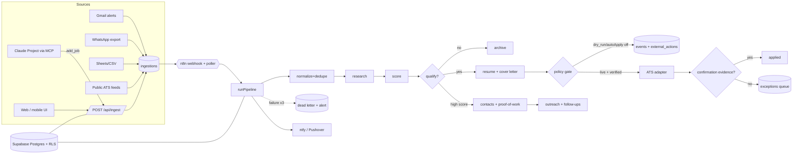

# Architecture

Seams: `Store` interface (packages/core) isolates all persistence; stage functions are dependency-injected into the orchestrator (`PipelineStages`); the LLM and all external senders have dry-run/stub defaults.

Failure model: each stage retries 3× with exponential backoff (500ms base); then the ingestion is `dead_letter`, an exception is raised, a notification is sent. Dead-lettered items are not reprocessed automatically (see RUNBOOK).
